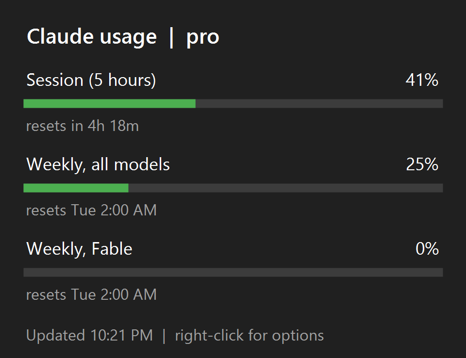
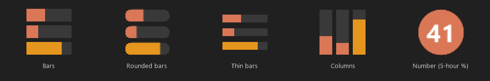
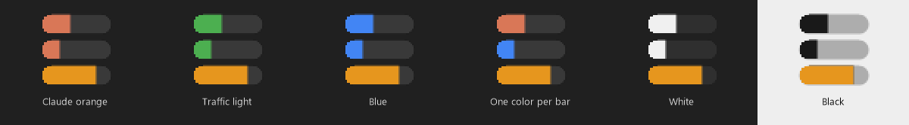

# Claude Usage Tray

A small taskbar / menu-bar widget that shows how much of your Claude plan limits you've used, like the menu-bar usage apps on macOS. It works on **Windows**, **macOS** and **Linux**.


The icon is three stacked bars:

| Bar | Limit |
| --- | --- |
| Top | 5-hour session |
| Middle | Weekly, all models |
| Bottom | Weekly, Fable |

Click the icon to see the details and when each limit resets:



## Features

- **Live usage** for your 5-hour session, weekly, and per-model weekly limits, with reset times.
- **Styles:** bars, rounded bars, thin bars, columns, or a single number.

  

- **Colors:** Claude orange, traffic light, blue, one color per bar, white (for dark taskbars) or black (for light taskbars). An optional switch turns the bars amber at 70% and red at 90%.

  

- **Refresh interval:** every 1, 3, 5, 10, 15 or 30 minutes, or every hour. Use a longer interval to save battery on a laptop.
- **Sharp on high-DPI screens:** the icon is drawn at your display's real pixel size.
- **Start at login,** from the menu.
- **No account setup:** it reuses the sign-in from [Claude Code](https://docs.claude.com/en/docs/claude-code/overview).

## Requirements

You need a Claude Pro or Max plan, and you need to be signed in to **Claude Code** on the same computer:

```bash
# Windows (PowerShell)
irm https://claude.ai/install.ps1 | iex
# macOS / Linux
curl -fsSL https://claude.ai/install.sh | bash
```

Then run `claude` once and sign in with your Claude account.

## Install

### Windows

1. Download the `windows` folder and put it somewhere permanent, for example `Documents\claude-usage-tray`.
2. Double-click **`Start-ClaudeUsageTray.vbs`**. The icon appears next to the clock. If you don't see it, check the `^` overflow menu; you can drag the icon from there onto the taskbar.
3. Right-click the icon and choose **Start with Windows**.

It needs nothing beyond what comes with Windows 10 and 11 (Windows PowerShell 5.1).

### macOS and Linux

```bash
cd mac-linux
sh install.sh
```

This installs the widget into `~/.local/share/claude-usage-tray`, along with its two Python libraries ([pystray](https://pypi.org/project/pystray/) and [Pillow](https://pypi.org/project/pillow/)) in a private virtual environment, and starts it. Click the icon and choose **Start at login**.

- **macOS:** needs `python3`. If you don't have it, run `xcode-select --install`.
- **Linux:** needs a system tray with AppIndicator support. On Ubuntu or Debian:
  ```bash
  sudo apt install python3-gi gir1.2-ayatanaappindicator3-0.1
  ```
  Plain GNOME also needs the *AppIndicator and KStatusNotifierItem Support* extension; Ubuntu includes it already.

## Menu

| Item | What it does |
| --- | --- |
| Refresh now | Updates right away |
| Refresh every | Sets how often it checks (1 minute to 1 hour, default 5 minutes) |
| Style | Bars, rounded bars, thin bars, columns, or number |
| Color | Color theme, plus the amber/red warning switch |
| Open usage on claude.ai | Opens your usage page |
| Start with Windows / Start at login | Starts the widget automatically |
| Exit / Quit | Closes the widget |

On Windows, left-click opens the details popup and right-click opens this menu. On macOS and Linux, clicking the icon opens one menu with both.

## How it works

The widget reads the sign-in that Claude Code saves on your computer:

- Windows and Linux: `~/.claude/.credentials.json`
- macOS: the Keychain item `Claude Code-credentials`

It then asks Anthropic's servers for your current usage. When the sign-in expires, the widget renews it and saves the new one back to the same place, so Claude Code keeps working too. Your sign-in is only ever sent to Anthropic.

Settings are saved in `settings.json` next to the script on Windows, and in `~/.config/claude-usage-tray/settings.json` on macOS and Linux.

## Troubleshooting

- **The icon shows `?` (Windows) or hollow bars (macOS/Linux):** hover over it, or click it, to read the error. Usually you need to run `claude` and sign in again.
- **No Fable bar:** the bottom bar shows only a grey track when your plan has no separate Fable limit.

## Disclaimer

This is an unofficial community project and is not affiliated with or endorsed by Anthropic. It uses the same usage endpoint that Claude Code uses, which Anthropic doesn't document, so it may stop working if Anthropic changes it.

## Credits

Created by **[@lemonspitz](https://github.com/lemonspitz)**.

## License

[MIT](LICENSE)
